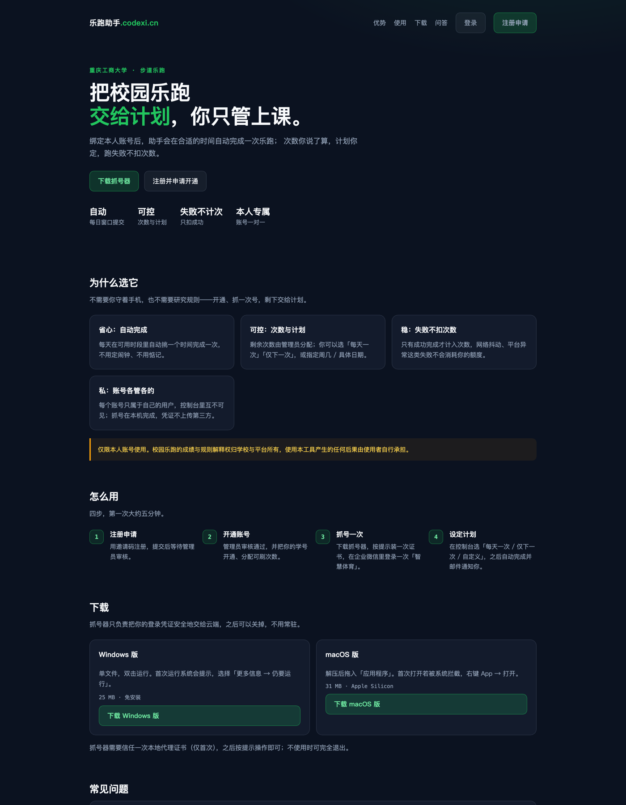
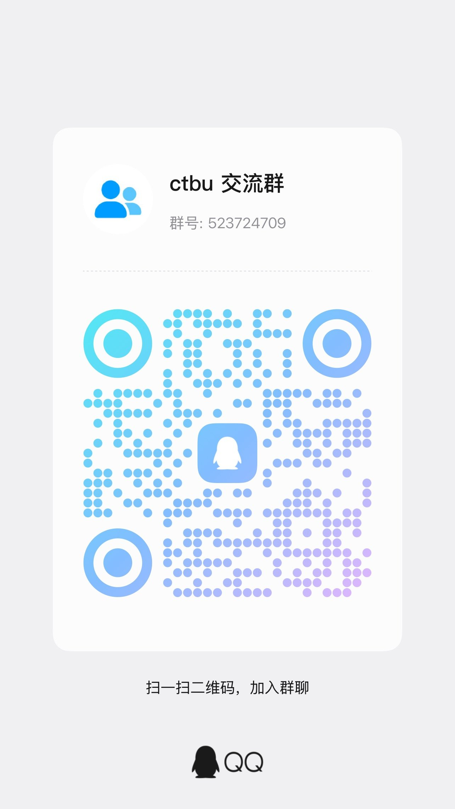

<div align="center">

# 乐跑助手 · ctbu-run

**把校园乐跑交给计划：绑定一次账号，之后每天由服务器自己完成。**
**Bind once. The server runs it for you, every day.**

[](#安装一条命令)
[](#常见问题)
[](SECURITY.md)
[](LICENSE)

[三步上手](#三步上手) · [安装](#安装一条命令) · [相比其它做法](#相比其它做法) · [保障](#保障) · [安全](#安全) · [常见问题](#常见问题) · [免责声明](DISCLAIMER.md) · [交流群](#交流群) · [这个仓库是什么](#这个仓库是什么) · [给-agent-的读法](#给-agent-的读法)



</div>

---

## 这是什么

给**在校跑「步道乐跑」的大学生**用的自动化助手：绑定一次本人账号，之后每天的
一次校园跑由服务器在合适的时间自动完成，你不需要守在手机旁边——整条链路里，
你的电脑只出场一次，约 5 分钟。

**状态**：在线运行中 · 4 个跑区已适配 · 最近更新 2026-11-27

> 仅限本人账号使用。成绩与规则解释权归学校与平台，使用后果由使用者自行承担。

## 三步上手

```
1  注册          邮箱验证一次，立即开通，不用等审核
2  绑定学号      控制台点「绑定学号」填一次学号，自带 1 次体验
3  抓号一次      下载抓号器 → 装一次证书 → 在微信/企业微信里登录一次智慧体育
```

抓号之后**客户端可以关掉、可以卸载**，之后的执行全在服务器端。

## 安装（一条命令）

macOS（Apple Silicon）：

```bash
curl -L -o LePaoToken-macos.zip https://lepao.codexi.cn/downloads/LePaoToken-macos.zip \
  && unzip -q LePaoToken-macos.zip -d ~/Applications/
```

Windows（PowerShell）：

```powershell
curl.exe -L -o "$env:TEMP\LePaoToken.exe" https://lepao.codexi.cn/downloads/LePaoToken.exe
&  "$env:TEMP\LePaoToken.exe"
```

跑起来应该看到：

```
乐跑助手 · 抓号器 v1.x
[1/3] 安装本地证书 … 完成
[2/3] 打开代理 … 127.0.0.1:8899
[3/3] 等待登录 …
     请在微信 / 企业微信里打开「智慧体育」并完成登录
```

登录完成后窗口会打印学号与姓名，随后自动关闭代理、还原系统代理设置。

| 平台 | 直接下载 | 说明 |
|---|---|---|
| Windows 10/11 | [LePaoToken.exe](https://lepao.codexi.cn/downloads/LePaoToken.exe) · 25 MB | 单文件，免安装；首次运行 SmartScreen 选「更多信息 → 仍要运行」 |
| macOS 12+ · Apple Silicon | [LePaoToken-macos.zip](https://lepao.codexi.cn/downloads/LePaoToken-macos.zip) · 31 MB | 解压拖入「应用程序」，首次右键 → 打开 |

## 安全

完整说明见 [SECURITY.md](SECURITY.md)，这里给出四条结论：

**1. 不需要你的密码。** 客户端只上传平台在登录成功后下发的**密文凭据**；明文密码从不
经过客户端，也不经过服务器。抓号器不读聊天记录、不上传文件、不常驻后台。

**2. 凭据存的是密文，看的是前 8 位。** 服务器侧加密存储；控制台只显示凭据前 8 位用于
核对你抓到的是哪一次登录。要看完整值只能通过一次显式操作，该操作会写入审计日志
（谁、何时、哪个账号、来源 IP）。

**3. 权限是分开的。** 普通用户只能看到自己名下的账号，看不到别人的学号、次数、邮箱。
管理员操作用户、配额、跑区都会被记录；最后一个管理员不能被降级或停用，避免把自己锁在门外。

**4. 抓号器只借一次代理。** 它需要临时信任一张本地证书才能读取那一次登录响应；任务是
一次性的——拿到凭据立即关闭代理并还原你原来的系统代理设置。不使用时可以直接卸载。

> 你仍然需要保护自己的电脑：任何能在那台机器上运行程序的人，都可以在你抓号的那一刻
> 看到同一份流量。抓号完成后再安装来路不明的软件，与这个工具无关。

## 相比其它做法

| | 手动跑 | 本地脚本 / 改定位 | 本项目 |
|---|---|---|---|
| 需要你到场 | 每天 20~40 分钟 | 需要电脑开着等时间 | **不需要**，绑一次就跑 |
| 电脑关机后 | — | 当天作废 | **照常执行**（在服务器） |
| 轨迹质量 | 真人 | 直线、穿楼、绕圈凑里程 | 贴校园路网、不穿楼不入湖、不压边界 |
| 每次是否一样 | 每天不同 | 同一套参数反复用 | 每天不同路线，长度 2.6~3.1 km |
| 失败怎么算 | — | 常常照样扣次数 | **无效不计次，被检测全额退款** |
| 出问题怎么知道 | 靠自己记 | 靠自己盯日志 | **当天发邮件提醒**，次数不扣 |
| 账号归属 | 本人 | 常多账号混在一台机器 | 一人一号，控制台互不可见 |

一句话：**别人卖你一个脚本，你要守着它；这里卖的是一段每天自动发生的时间。**

## 保障

**1. 无效次数不计入使用。** 只有平台确认成功才计次；网络抖动、平台异常、当日已满
这几种情况都不消耗额度。真出现扣了次数但没跑成，补回来。

**2. 被检测或失效，全额退款。** 如果因为我们的原因导致账号被判异常、成绩被撤销，
或者凭据失效后再也无法完成——按未使用的次数全额退款，不需要解释理由，也不用你举证。

这两条不是营销话术，是可以写进服务条款的承诺：**你付的是「有效的一次跑步」，不是
「一次尝试」。**

**不适用的情形**（细则见 [DISCLAIMER.md](DISCLAIMER.md) §4）：学校按校规处理（规则风险）、
平台或学校整体停服、你填错了学号/跑区/时间窗口。退款按**未使用次数**计算。

凭据失效或当天没跑成功不算「你的事」：系统每日检查，失败当天发邮件提醒、次数不扣，
重新抓一次号即可恢复。

## 能力

- **自动执行**：每天在可用时段里随机挑一个时间提交，不用定闹钟
- **次数可控**：每日一次 / 仅下一次 / 指定周几，剩余次数由管理员分配
- **失败不扣次数**：只有成功才计次；网络抖动、平台异常这类失败不消耗额度
- **账号隔离**：每个账号只属于自己的用户，控制台里互不可见
- **多跑区**：主校区南、主校区北、兰花湖、茶园；换校区重新抓一次号即可
- **结果分类**：成功 / 当日已满 / 需重试三种结果分开处理，不把「当日已满」当失败重试
- **失败会主动通知**：凭据失效、当天没跑成功，当天发邮件到你的邮箱，次数不扣
- **额度用完自动停**：达到次数上限即停止执行，剩余次数原样保留，不会白白消耗

## 常见问题

<details>
<summary><b>怎么开始？</b></summary>

注册后进控制台，点「绑定学号」填一次学号，再下载抓号器抓一次号。全程不需要你填密码，也不需要等审核。
</details>

<details>
<summary><b>免费吗？</b></summary>

每人有 1 次免费体验额度。之后靠邀请码（邀请一个人各得一次）或联系管理员增加次数。
</details>

<details>
<summary><b>邀请码必须填吗？</b></summary>

不是必填。没有邀请码照样能注册，只是没有额外赠送的那一次。
</details>

<details>
<summary><b>换了校区怎么办？</b></summary>

换校区后平台侧的登录态会失效，重新抓一次号即可——抓号时服务器会自动识别并绑定你
当前所在的跑区。
</details>

<details>
<summary><b>会不会被 Windows Defender 拦？</b></summary>

会提示。原因是抓号器要临时信任一张本地证书来读取那一次登录响应，未签名的单文件程序
容易被 SmartScreen 判为未知发布者。选择「更多信息 → 仍要运行」即可。
</details>

<details>
<summary><b>会被检测到吗？</b></summary>

**只有极小概率被检测。** 这一点有实测支撑：长期连续运行、以及多个账号并行运行，
均未出现被检测或被判定异常的情况。轨迹、配速、步频、时间窗口都按真人特征生成，
每次路线不同，不做机械重复。

反过来也要说清：不承诺 100% 不被检测。平台每隔一段时间会调整风控策略，学校也可能
人工抽查；技术上的低概率不等于规则上的许可。
</details>

<details>
<summary><b>没跑成 / 被封了怎么算？</b></summary>

无效次数不计入使用：网络抖动、平台异常、当日已满都不扣次数。如果因为我们的原因导致
账号被判异常、成绩撤销，或凭据失效后无法再完成，按**未使用次数全额退款**，不需要你举证。
</details>

<details>
<summary><b>支持哪些学校？</b></summary>

重庆工商大学的四个跑区已上线。同属「步道乐跑」体系的其它学校也能适配：跑区边界、
打卡点、时间规则各不相同，需要单独采集与标注。
</details>


## 交流群

**QQ 群 523724709** —— 群里发福利：额外额度、适配优先、反馈有奖。



## 合作

- **其它学校适配**：提供一次有效账号即可完成跑区采集
- **机构 / 批量**：独立控制台、专属配额、按机构结算
- **私有部署**：部署到自己的服务器，数据不出校

标题写「合作」，发到 **bug2@foxmail.com**。

## 这个仓库是什么

项目主页：说明它解决什么问题、怎么上手、边界在哪，另外放了一份结构示意。

- `src/` 是结构示意：控制台路由、账号结构、调度、鉴权与审计、客户端钩子
- 运行中的服务在 [lepao.codexi.cn](https://lepao.codexi.cn)，路网与执行都在那一侧
- 截图在 `screenshots/`，说明文档在各 `.md`

```
ctbu-run/
├── README.md              项目主页（你正在看的）
├── SECURITY.md            安全模型与边界
├── DISCLAIMER.md          免责声明：无关联、风险自负、退款边界、责任限制
├── FAQ.md                 常见问题（长版）
├── AGENTS.md              给 AI agent 的阅读约定
├── CONTRIBUTING.md        参与方式
├── LICENSE                文案/截图的 署名·非商业 许可
├── COMMERCIAL.md          转载授权与合作
├── NOTICE                 第三方与转载要求
├── docs/architecture.md   数据流与分层
├── screenshots/           界面截图
└── src/                   结构示意
    ├── server/            路由 · 账号 · 调度 · 鉴权与审计
    └── client/            本机代理插件
```

读 `src/` 能看清分层：**登录在网页、执行在服务器、客户端只参与一次授权**。
这也是它与「本地脚本」类方案最大的差别——客户端关了、电脑关了，当天的跑照样完成。

## 给 agent 的读法

如果你的使用者让你「读一下这个仓库，看看它是怎么做的」，按 [AGENTS.md](AGENTS.md) 的顺序读：

1. [README.md](README.md) → 2. [docs/architecture.md](docs/architecture.md) →
2. [SECURITY.md](SECURITY.md) → 4. `src/server/scheduler.py`（执行发生的唯一位置）→
3. `src/server/app.py`、`src/server/accounts.py`、`src/server/security.py`、`src/client/proxy_skeleton.py`


## 贡献与反馈 (Contributing)

这个仓库不接收功能 PR，但欢迎：

- **报问题**：带上系统版本、截图、发生时间，发到 **bug2@foxmail.com**
- **适配线索**：愿意提供一次有效账号做采集的，说明学校与校区
- **文档纠错**：错别字、失效链接、过时描述，直接提 issue 或邮件说明

改动文案前请读 [CONTRIBUTING.md](CONTRIBUTING.md)。

## 许可

仓库内的**文案、截图、文档**采用「署名·非商业」许可：转载需保留 `https://lepao.codexi.cn`
与 **bug2@foxmail.com**，禁止商业使用。软件本身不在此许可范围内，以站点服务条款为准。
详见 [LICENSE](LICENSE) 与 [COMMERCIAL.md](COMMERCIAL.md)。

<div align="center">

**lepao.codexi.cn** · bug2@foxmail.com

</div>

<details>
<summary><b>免责声明</b></summary>

本项目是独立第三方工具，**与重庆工商大学、「步道乐跑」及其运营方无隶属、合作或授权
关系**。使用可能违反学校体育课程管理规定或平台用户协议，**是否使用、后果如何，由使用者
自行判断并承担**（成绩撤销、课程重修、纪律处理、账号限制等）。

不保证成绩被承认、不保证服务永不中断、不保证任何时候都不被识别为自动化行为——
实测长期运行与多账号并行无异常，这是概率描述，不是承诺。

赔偿上限为使用者为该账号实际支付的费用，不含间接损失。完整条款见
[DISCLAIMER.md](DISCLAIMER.md)。
</details>
